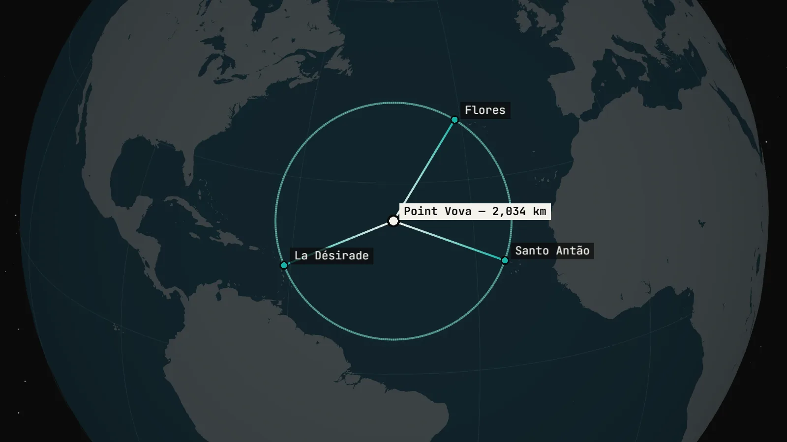
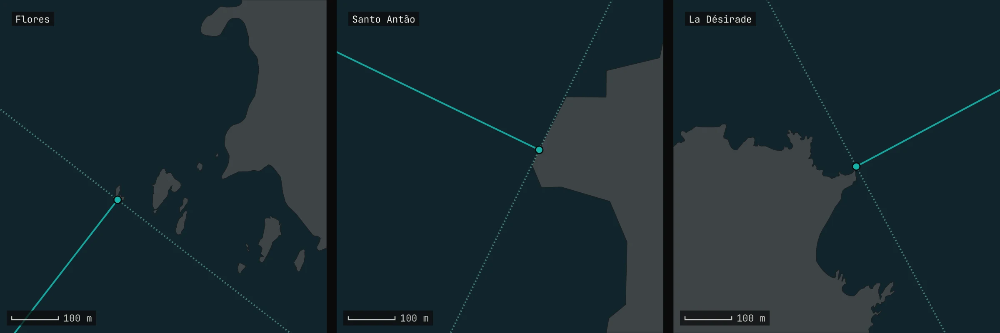

# Point Vova

The point in the Atlantic Ocean farthest from land, computed from open data. This repository holds the code, the coastline data and the results behind the article [Point Vova](https://vova.today/en/works/point-vova/) ([по-русски](https://vova.today/ru/works/point-vova/)).

| | |
|---|---|
| Coordinates | 24.1852° N, 43.3709° W (24°11′07″ N, 43°22′15″ W) |
| Distance to the nearest land | 2,033.9 km |
| Nearest land, three places at once | a rock off Flores (Azores), Santo Antão (Cape Verde), La Désirade (Guadeloupe) |
| Stability of the position | about 150 m (see [How sure](#how-sure)) |
| Ellipsoid | WGS84 |
| Coastline | OpenStreetMap of 11 November 2026 near the pole, GSHHG 2.3.7 elsewhere |



## What this is

The Atlantic pole of inaccessibility was computed by Richard Barnes in 2019 ([doi:10.1080/17538947.2019.1576786](https://doi.org/10.1080/17538947.2019.1576786)). He did not name it.

This is an independent calculation. Barnes's coordinates are not an input: the search starts from this project's own scan of the whole Atlantic. The two results are 50 m apart.

What this calculation adds:

- an exact algorithm: it solves for the centre of the circle instead of searching for it;
- the three places where the circle touches land, down to the OpenStreetMap way and node;
- how far the point moves when small rocks are left out of the coastline;
- where the 50 m between the two results come from: 41 m from changes to the map, 31 m from the algorithm (see [Compared with Barnes](#compared-with-barnes-2019));
- a name. I call the point Point Vova. The name is informal. No body names computed points on the high seas; Hrvoje Lukatela, who computed Point Nemo, named it himself.

## The three shores

| Bearing from the point | Where | Coastline vertex | OpenStreetMap |
|---|---|---|---|
| 31.2° | a rock of 286 m² off Ponta dos Ilhéus, south-west Flores, Azores | 39.3762529, -31.2531641 | [way 319479621](https://www.openstreetmap.org/way/319479621), [node 3258947501](https://www.openstreetmap.org/node/3258947501) |
| 109.4° | the west coast of Santo Antão, Cape Verde | 17.0603992, -25.3587267 | [way 302291258](https://www.openstreetmap.org/way/302291258), [node 80002310](https://www.openstreetmap.org/node/80002310) |
| 248.1° | Pointe du Grand Abaque, La Désirade, Guadeloupe | 16.3489497, -61.0075720 | [way 42024315](https://www.openstreetmap.org/way/42024315), [node 9570455415](https://www.openstreetmap.org/node/9570455415) |

All three are 2,033.896 km from the point. The next land is Barbuda, 7.6 km farther.



## Method

A pole of inaccessibility is the centre of the largest circle that fits in the sea without touching land. Such a circle touches land in three places, and the three surround the centre: move the centre anywhere and one of them comes closer.

1. **Coarse search** (`pointvova/scan.py`). A quarter-degree grid over the whole Atlantic, spherical distance to the nearest GSHHG vertex. The best cell is at 24.125° N, 43.375° W, 2,030 km from land. The second best, in the South Atlantic, is 1,789 km from land, so there is one candidate.
2. **Coastline** (`pointvova/gshhg.py`, `pointvova/osm.py`). GSHHG 2.3.7 at full resolution for the world. Inside six boxes around the nearest shores, GSHHG is replaced by the OpenStreetMap coastline, which maps single rocks.
3. **Refinement** (`pointvova/solve.py`). Start at the best cell of the coarse search, 6.7 km from the answer. Find the nearest coastline vertex on each of the three nearest shores. Move the point by Newton's method until the three geodesic distances are equal. Repeat until nothing moves. It takes three rounds, and the three distances then agree to less than a micrometre.
4. **Checks** (`pointvova/solve.py`, `pointvova/edges.py`). Every coastline vertex within 30 km of the circle is measured exactly (17,883 vertices), and none is inside. Every coastline segment near the circle is measured too (17,882 segments), because land is the line between the vertices. No segment comes nearer than its ends, so the circle touches land at three vertices. The gaps between the bearings to the three shores are 78°, 139° and 143°, all under 180°, so the point is a maximum.

Distances are geodesics on the WGS84 ellipsoid, computed with [GeographicLib](https://geographiclib.sourceforge.io/) (Karney 2013). Spherical distances serve only to choose which vertices to measure exactly, with a margin wider than the two can disagree by.

## How sure

One run computes these variants. The table is `results/summary.md`.

| Variant | Latitude | Longitude | Distance to land, km | Away from the result, m |
|---|---|---|---|---|
| OpenStreetMap of 11 November 2026 near the pole, WGS84 (the result) | 24.185247 | -43.370870 | 2033.8959 | 0 |
| the same without islets under 500 m² | 24.185394 | -43.370874 | 2033.9016 | 16 |
| the same without islets under 1,000 m² | 24.185486 | -43.370876 | 2033.9052 | 26 |
| the same without islets under 5,000 m² | 24.186549 | -43.370902 | 2033.9468 | 144 |
| the same without islets under 10,000 m² | 24.186549 | -43.370902 | 2033.9468 | 144 |
| the same on a sphere | 24.213796 | -43.373752 | 2033.9185 | 3176 |
| OpenStreetMap of 26 April 2017 near the pole, WGS84 | 24.185373 | -43.370487 | 2033.8638 | 41 |
| GSHHG alone, WGS84 | 24.192633 | -43.372931 | 2033.4981 | 844 |
| GSHHG alone, sphere | 24.221163 | -43.375885 | 2033.5209 | 4011 |
| Barnes 2019, OpenStreetMap | 24.1851 | -43.3704 | 2033.8849 | 50 |
| Barnes 2019, GSHHG 2.3.6 | 24.1923 | -43.3728 | 2033.5187 | 805 |

- **Small rocks.** The rock off Flores is 286 m² and GSHHG does not have it. Without it the point moves 16 m. Without every islet under one hectare it moves 144 m. "About 150 m" is this number rounded up.
- **An older map.** On the OpenStreetMap coastline of April 2017 the point is 41 m away.
- **A coarser coastline.** On GSHHG alone the point is 844 m away. That run is 39 m from Barnes's own GSHHG point.
- **A sphere.** On a sphere instead of the ellipsoid the point is 3.2 km to the north.
- **A shore that moves.** One metre of shore moves the point by at most 0.85 m.

## Compared with Barnes (2019)

| | Barnes (2019) | Here |
|---|---|---|
| Coastline | OpenStreetMap land polygons of 26 April 2017 | OpenStreetMap of 11 November 2026 near the pole, GSHHG 2.3.7 elsewhere |
| Distances | WGS84, GeographicLib | WGS84, GeographicLib |
| Land | coastline vertices, plus points every 500 m on longer segments | coastline vertices, then every segment checked |
| Nearest land | the coastline point nearest by straight line in Cartesian space; the distance to it is then measured on the ellipsoid | the coastline point nearest on the ellipsoid |
| Finding the centre | hill climbing with simulated annealing; separate runs within 10 m of each other | Newton's method on the three distances; they agree to under a micrometre |
| Result | 24.1851° N, 43.3704° W, 2,033.8849 km | 24.185247° N, 43.370870° W, 2,033.8959 km |

The two points are 50.5 m apart. Barnes prints four decimals, which is about 10 m. The 50 m have two causes, and this repository measures both. The two shifts point in different directions, so 41 m and 31 m make 50 m together, not 72.

**The map changed: 41 m.** On the OpenStreetMap coastline of 26 April 2017, the date of Barnes's data, this solver gives 24.185373° N, 43.370487° W, 2,033.8638 km. That is 41.4 m from the result. The rock off Flores and the contact on Santo Antão are the same nodes in 2017 and in 2026. The coast of La Désirade was redrawn in between, and the contact there is 571 m from where it was.

**The algorithm: 31 m.** On that 2017 coastline the pole is still 31.5 m from Barnes's point. His printed distance to land is 21.1 m longer than the largest that coastline allows. His paper says how the nearest land is found (section 2.6): the coastline points are "projected into Cartesian 3-space" and indexed, and "once a vertex's nearest neighbour was identified, great ellipse distances were calculated". The nearest point by straight line, through the Earth, is not always the nearest on the ellipsoid. A search built that way ends where the three shores are equally far by straight line, and reports the largest of the three surface distances there.

`pointvova/straightline.py` finds that point on the 2017 coastline: 24.185125° N, 43.370462° W, with 2,033.8859 km to the farthest of the three shores. That is 6.9 m from the point Barnes prints and 1.0 m from the distance he prints. The real distance to land at that point is 2,033.8523 km, which is 11.5 m less than at the pole of the same coastline.

What this rests on:

- The 2017 coastline here is OpenStreetMap as it stood on 26 April 2017 at 08:54 UTC, taken from the Overpass API. Barnes used the land polygons file of that date, which is not reproduced here. The newest edit in the six boxes is of 30 March 2017.
- His code was not examined. The reading of his method comes from the paper's text. The match of 6.9 m and 1.0 m is the evidence for it.

So the algorithm here is more exact, by 31 m on his data. The position is still limited by the coastline to about 150 m.

## Limits

- **OpenStreetMap covers six boxes, not whole islands:** the west of Flores (two boxes), the west of Santo Antão, La Désirade, Petite-Terre and the east of Barbuda. Outside them the coastline is GSHHG. The nearest GSHHG coastline is Flores just east of its box, 3.7 km farther from the point than the three shores. A rock missing from GSHHG would have to lie more than 3.7 km off that coast to change the result.
- **The tide.** OpenStreetMap draws the coastline at high water. Nothing here shows whether the rock off Flores stays dry at the highest tide. If it does not, the point moves 16 m.
- **The date.** The coastline is that of November 2026. Mappers redraw capes and storms break rocks, and the point moves with them.
- **Satellite imagery.** The three contacts were compared by eye with Esri World Imagery, about 1 m per pixel. All three are rocks at the waterline. The imagery is not in this repository.
- **The pictures** in `figures/` come from the article. This code does not produce them.

## Run it

Tested with Python 3.8.10, numpy 1.23.5, scipy 1.10.1 and geographiclib 2.1.

```
git clone https://github.com/vova-today/point-vova
cd point-vova
pip install -r requirements.txt
```

Download [gshhg-bin-2.3.7.zip](https://www.soest.hawaii.edu/pwessel/gshhg/) (119 MB) and put its `gshhs_f.b` in `data/gshhg/`. Then:

```
python -m pointvova
```

The run takes about four minutes and rewrites `results/`. It stops if a check fails or if the point is not the published one.

## Files

| | |
|---|---|
| `pointvova/` | the code; `__main__.py` runs all of it |
| `data/osm/2026-11-11/` | the OpenStreetMap extracts the result is computed from |
| `data/osm/2017-04-26/` | the same six boxes as they were on the date of Barnes's data |
| `results/straight-line-2017.json` | the point a straight-line nearest-neighbour search gives on the 2017 coastline |
| `results/point-vova.json` | the result at full precision, with the checks |
| `results/summary.md` | every number quoted in this file |
| `results/runs/` | the other variants of the table |
| `results/scan.json` | the coarse search's maxima |
| `results/edges.json` | the check against coastline segments |
| `results/point-vova.geojson` | the point, the three contacts, the radii and the circle, as geodesics |
| `figures/` | the two pictures from the article |

## Cite

Terentyev, V. (2026). Point Vova. VOVA.TODAY. https://vova.today/en/works/point-vova/

## Licence

Everything I made here is free to take, remix, and reuse, including in commercial projects, with no attribution required: [CC0 1.0](LICENSE). Third-party material stays under its own licences:

- `data/osm/` and the coastline in `figures/shores-en.webp`: © OpenStreetMap contributors, [ODbL 1.0](https://www.openstreetmap.org/copyright).
- `figures/globe-en.webp` is a picture of the map at [line.vova.today](https://line.vova.today/en). Its coastline is GSHHG.
- GSHHG (Wessel and Smith), not included: LGPL.
- GeographicLib (Karney), a dependency: MIT.

## Sources

- Barnes, R. (2019). Optimal orientations of discrete global grids and the Poles of Inaccessibility. *International Journal of Digital Earth*. [doi:10.1080/17538947.2019.1576786](https://doi.org/10.1080/17538947.2019.1576786)
- Karney, C. F. F. (2013). Algorithms for geodesics. *Journal of Geodesy*. [doi:10.1007/s00190-012-0578-z](https://doi.org/10.1007/s00190-012-0578-z)
- Wessel, P., and Smith, W. H. F. (1996). A global, self-consistent, hierarchical, high-resolution shoreline database. *Journal of Geophysical Research*. [GSHHG 2.3.7](https://www.soest.hawaii.edu/pwessel/gshhg/)
- Lukatela, H. [Point Nemo](http://www.lukatela.com/pointNemo/) (2004) and [Point Nemo, revisited](http://www.lukatela.com/pointNemoRevisited/index.html) (2022).
